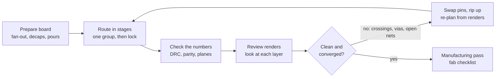

# Agentic PCB routing with Claude: what worked

2026-11-14 · copy of the shared doc at https://claude.ai/artifact/R7VKFZnUAvHN7uRxqj7ASq (written about the Ti60F225 card)

## Summary

Claude routed a dense 6-layer FPGA card (Efinix Ti60F225, 0.65 mm BGA, 153 parts, 32.6 × 33.9 mm) to 0 unconnected items and a clean DRC, with 88 signal vias. What made it work was not a better autorouter but the setup around it:

1. **Claude drives real routers through scripts it can rerun**, never one-off GUI edits, so every schematic change or pin swap is pushed through the whole chain again.
2. **The board is prepared before routing**: placement, BGA fan-out, decoupling and planes are their own steps, each checked.
3. **Routing is staged**: one group of nets at a time, finished groups locked, the hardest constraints first.
4. **Pin mapping is part of routing**: interchangeable FPGA pins and translator channels are swapped whenever that removes a crossing or a via.
5. **Every run is checked twice**: by numbers (DRC, unconnected, schematic parity, plane islands, via counts) and by looking at rendered images of each copper layer.
6. **Long routing runs go to subagents** with a written brief, in separate git worktrees, so different models or approaches can be compared.

## Toolchain

Claude Code in a terminal, running scripts against KiCad files. No MCP server and no GUI automation were needed.

| Tool | Used for |
| --- | --- |
| KiCad 10 (AppImage), its bundled Python with `pcbnew` | Every board edit as a script: placement, vias, zones, fiducials, fixes |
| `kicad-cli` | DRC with zones refilled, schematic parity, ERC, netlists, PDF export |
| [KiCadRoutingTools](https://github.com/drandyhaas/KiCadRoutingTools) (KRT) | BGA fan-out, signal routing, length matching, plane pours, a placer |
| `pdftoppm` | Turns a per-layer PDF into a PNG that Claude reads as an image |
| FPGA vendor tool (Efinity) | Checks every pin swap: I/O standards, bank limits, timing |
| git | One commit per finished step; worktrees for parallel agents |

Tips that saved time:

- Run KRT with the KiCad Python visible to it. Without it, KRT's pour and plane checks switch off silently.
- Render with `kicad-cli pcb export pdf --layers <layer>,Edge.Cuts`, then crop the page to the board outline with `pdftoppm -x -y -W -H`. About 1000 dpi (39 px/mm) shows a 0.65 mm BGA clearly.
- On WSL, open renders on the Windows desktop with `explorer.exe "$(wslpath -w file.png)"`.

## Principle: a pipeline you can rerun

The board is never hand-edited while layout is in progress. Each step is a script that reads one board file and writes the next, and two shell scripts chain them: one for layout, one for routing. Rebuilding from scratch took 1.5–5 minutes, so Claude reran it after every change.

Why it matters:

- A schematic change or a pin swap is applied by rerunning the chain, not by patching the old board.
- A bad idea costs one revert; the scripts and the board stay consistent.
- Steps can be inspected one at a time (`b0` … `b6` intermediate files), which is where most bugs were found.
- A subagent can pick the chain up from the repo without knowing the history.

Keep the routed board's file separate from the layout chain's default output. Once routing is done, running the layout chain with no argument would overwrite the routed board with an unrouted one.

## Before routing: prepare the board

Most routing failures come from the board handed to the router. These steps ran first, each as its own script:

1. **Sync and placement.** The netlist is synced from the schematic and the parts are placed by a floorplan script: the BGA's orientation, the memories, the translators in a row. KRT's placer handled small leftover parts.
2. **Via-in-pad for the BGA's plane balls.** On a 6-layer JLC order, filled and capped via-in-pad costs nothing extra, so every power and GND ball got a via in its pad.
3. **BGA fan-out** for the signal balls (KRT `bga_fanout`, under-pad escapes at 0.09 mm), with the escape corridors beyond the ball field kept free for later routes.
4. **Decoupling on its own vias.** A placer script puts each cap at its ball. Under the BGA it uses the lattice of ball vias and diagonal gaps: a 0201's pads (0.64 mm apart) land on two sites of the 0.65 mm grid.
5. **Supply copper.** Plane splits, buck output pours stitched to their plane, pads that lost their via tapped again, and a check that every plane via reaches its plane.

Audit what you inherit. This board came from an older design, and its pours, plane splits and some wide traces were stale. Leftover copper kept blocking routes until it was found and removed.

## The routing loop

A single “route everything” call tangled the board: it ran for 39 minutes, sent supply tracks through the busiest area and left 74 open items. The version that worked routes in stages and treats the pin mapping as something to change.

**Stage the nets.** Define groups in a JSON file and route them in this order, locking each finished group so later steps cannot rip it up:

1. Length-matched or high-speed buses (here the HyperRAM), on the top layer only.
2. The most constrained connector nets (translator outputs into a 1.27 mm header).
3. Configuration parts, JTAG and other cross-board nets.
4. Everything else, then supply taps, only once the pours exist and are filled.
5. A rescue pass that may rip up and reroute just the remaining open nets.

**Script what the router cannot do.** KRT could not thread a track between the header's first-row pads, so a small script draws those 15 stubs. Pull-up resistors were moved onto the connector pins they serve.

**Swap pins to untangle.** After each run, look for crossings and vias that a different pin order would remove. On this board, reordering the FPGA balls to follow the translator channels and the header's pin order made whole bundles cross-free. Keep a written list of which pins are interchangeable (same bank and voltage, no special function) and which are fixed. Check every swap with the FPGA vendor tool and the schematic checks before rerouting.

**Review renders, not just numbers.** DRC proves the copper is legal, not that the routing is good. After every run, render each copper layer and look for crossings, avoidable vias, detours, tangles and damage to the planes. Rip up and reroute the worst nets rather than patching them.

**Iterate until it stalls.** This board took 12 iterations. Open items went 74 → 57 → 49 → 39 → 0, and signal vias 136 → 88.

*The routing loop: 4 steps, 1 decision, 1 loop back.*

Each pass ends in a check and a look at the renders; anything open goes back through pin swaps or a rip-up before the next routing run.

## Checks after every run

One script runs them all and prints a short summary, so Claude (or a subagent) reads a few lines instead of a long log.

| Check | How | Pass |
| --- | --- | --- |
| DRC | `kicad-cli pcb drc --refill-zones --severity-all --format json` with the project's own rules | 0 errors |
| Unconnected | same report | 0 |
| Schematic parity | `--schematic-parity`, with the current schematic next to the board copy | 0 |
| Plane islands | pcbnew script: fill zones, count islands per plane net, list plane vias outside the main island | one island per net |
| Tracks on plane layers | pcbnew script | none on GND layers |
| Signal vias and bottom-layer track length | pcbnew script | falling run to run |
| ERC and schematic intent | `kicad-cli sch erc` plus a project checker script | 0 / 0 |
| Pin plan | FPGA vendor tool compile | PASS, timing met |

Put the fab limits in the project's rules file (`.kicad_dru`) so DRC enforces them: JLC's 0.2 mm via-hole-to-copper, 0.28 mm PTH hole-to-copper, 0.45 mm PTH hole-to-hole. Routing at 0.125 mm clearance with 0.30/0.15 mm vias meets the via rule by construction (0.125 + 0.075 ring = 0.2).

Clean up with DRC as the judge: a script deletes every track or via DRC flags as dangling, by its ID, and repeats until none are left. pcbnew's own connectivity test also calls a stub that ends in a pour “dangling”, so deleting by that test would cut pads off their pours.

## Briefing a routing agent

Routing runs for 1–1.5 hours, so it goes to a subagent with a written brief kept in the repo. The agent knows only what the brief says, so it should hold:

- **The goal and what “done” means**: 0 unconnected, DRC clean, parity 0, planes intact, few vias.
- **The stackup**: which layers may carry signals (here top + one inner layer) and which are never routed.
- **Fab rules** and the routing settings that meet them.
- **The tools and the chain**, with the exact commands.
- **The pin-swap rules**: fixed pins, interchangeable groups, the checks every swap must pass.
- **The order of work**: baseline run, render review, planned swaps, iterate.
- **Known traps** (next section), and where its memory notes live.
- **The report to return**: worktree and branch, numbers, swaps with reasons, review notes per iteration, render paths, what is left, what in the brief was wrong.

Run each agent in its own git worktree. That keeps the main checkout untouched and lets two agents work at once; merge the one you prefer. Here two models got the same brief: one reached 0 unconnected with 88 vias, the other stalled at 13 open items with about 196 vias. Both found largely the same pin swaps.

Ask for “what was wrong in the brief”. Both agents found real gaps (track width at the header, the router's missing KiCad Python, leftover copper), and those notes made the next brief better.

## Traps found on this board

| Trap | What happened | Fix |
| --- | --- | --- |
| Pours block the router | KRT routes no track through another net's pour | Drop inner pours before routing, pour again after |
| Router rips finished work | Later steps tore up earlier nets, even with KRT's “keep existing copper” setting | Lock each finished group of tracks |
| Fine-pitch header | 0.1 mm tracks missed clearance between 1.27 mm header pads by 0.0025 mm on a 0.025 mm grid | 0.09 mm tracks, or scripted stubs |
| Router without KiCad Python | KRT's pour and plane checks were silently off | Run it with KiCad's Python set |
| Supply routed as tracks | With the pour removed, supply pads got routed as tracks (50+ min) | Route supply taps only after the pour is filled |
| Inherited copper | Old pours, traces on plane layers and a wide trace above the header blocked routes | Audit and strip before routing |
| KiCad 10 Python | Crashes after `Remove()`, on `Fill()` with a temporary zone list, on `Flip()` of an unattached footprint | `b.Delete()`, hold `zones = b.Zones()`, add before flipping, save and reload between steps, run with `-u` |
| Wait loops never end | `until ! pgrep -f name` matches the loop's own command line | Wait on an output file or a marker that is really written |
| Pin data in several files | HyperRAM balls also lived in the FPGA project file and a checker table | List every file a swap must touch |
| Copied part numbers | Re-valued caps kept their old LCSC and MPN | Set value, footprint, LCSC and MPN together |
| Login errors in long runs | A network drop gave Cloudflare 403s, shown as “please /login”, and stopped both agents | Resume the agents; work in the worktrees survives |

## Results and what is still hard

The routed board passes DRC and matches the schematic. Still open, and where Claude needs your judgement:

- **Plane integrity versus layer limits.** Keeping one inner layer for signals and its power pour in one piece conflict for nets that cross the board. The agent put JTAG and the power-good lines on the bottom layer (318 mm) to protect the pour; the pour still has 8 small islands. The brief should set the priority.
- **Length matching in tight bundles.** KRT found no room to meander the 0.225 mm-pitch HyperRAM bundle; lengths run 8.6–14.2 mm. Decide whether the controller tolerates the skew or meander by hand.
- **Placement drives everything.** Pin swaps fixed most crossings, but some problems need a different placement. A follow-up experiment turns the FPGA 90° and swaps the two memories to bring JTAG and the flash next to their connector.
- **Manufacturing review is a separate pass.** A checklist (via sizes, mask dams, fiducials, edge distance, assembly rotations, stock) found an undersized via, missing fiducials and dangling stubs after routing was “done”.

Related: [KiCadRoutingTools](https://github.com/drandyhaas/KiCadRoutingTools), and Anthropic's write-up of [Claude designing electronics with Diode](https://www.anthropic.com/research/claude-electronics-design), which uses a similar approach: Claude's own router plus checks it writes, then rip-up and reroute.
